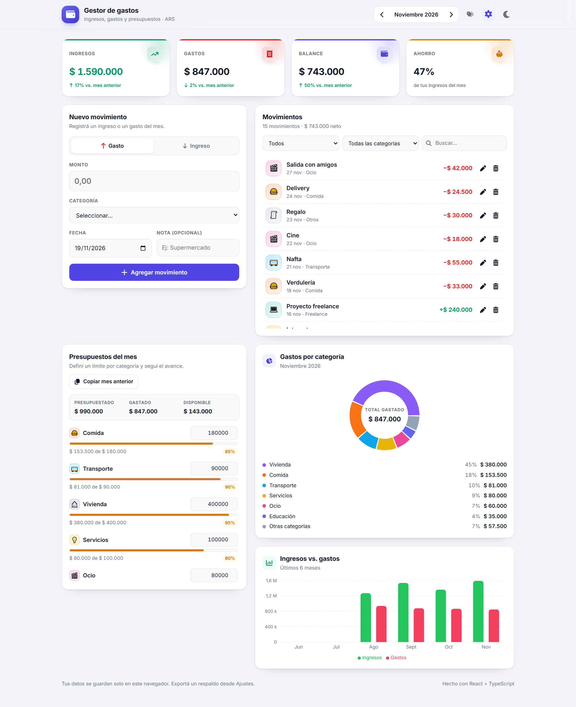
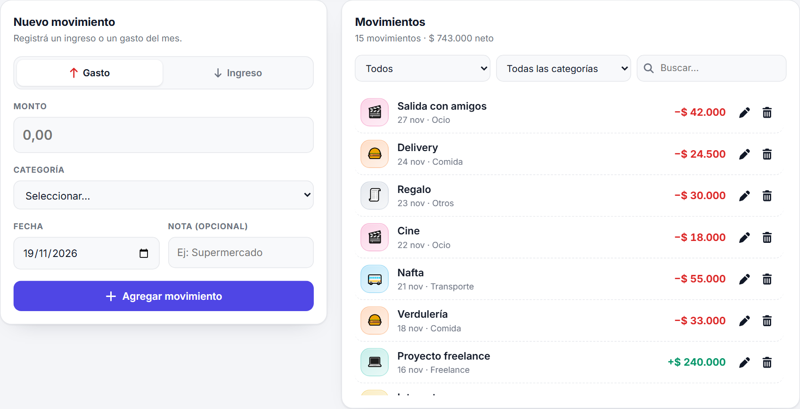
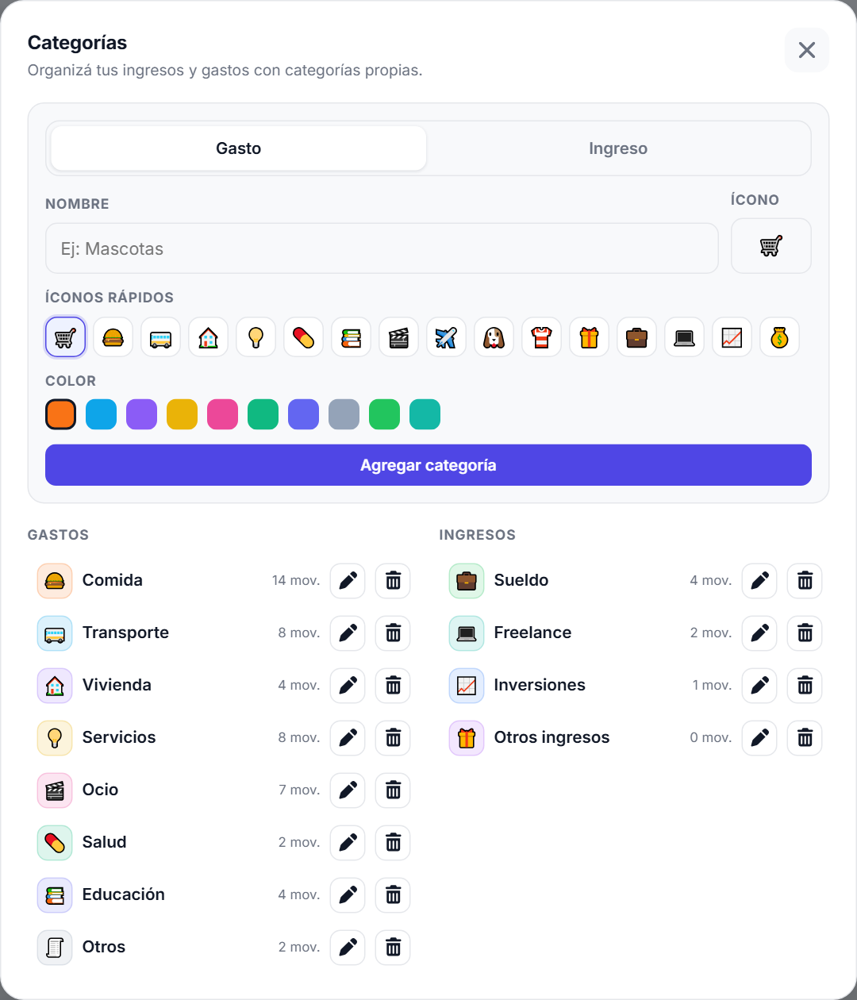
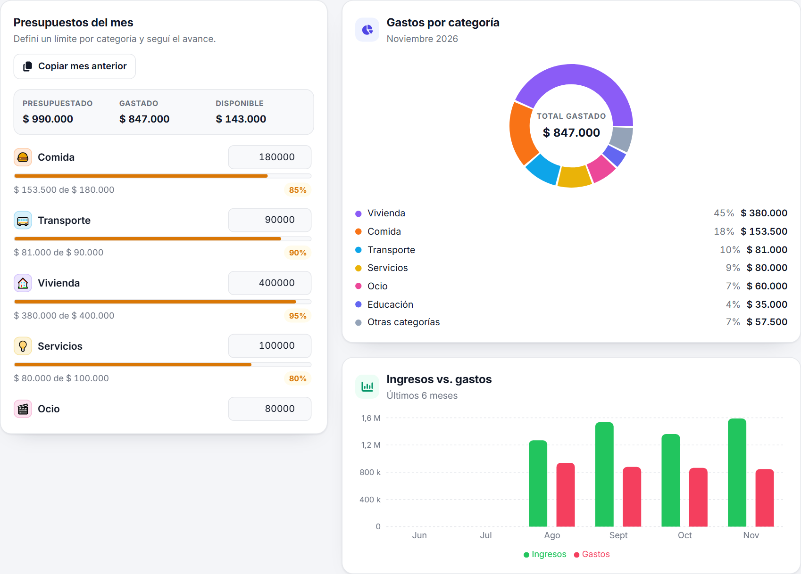
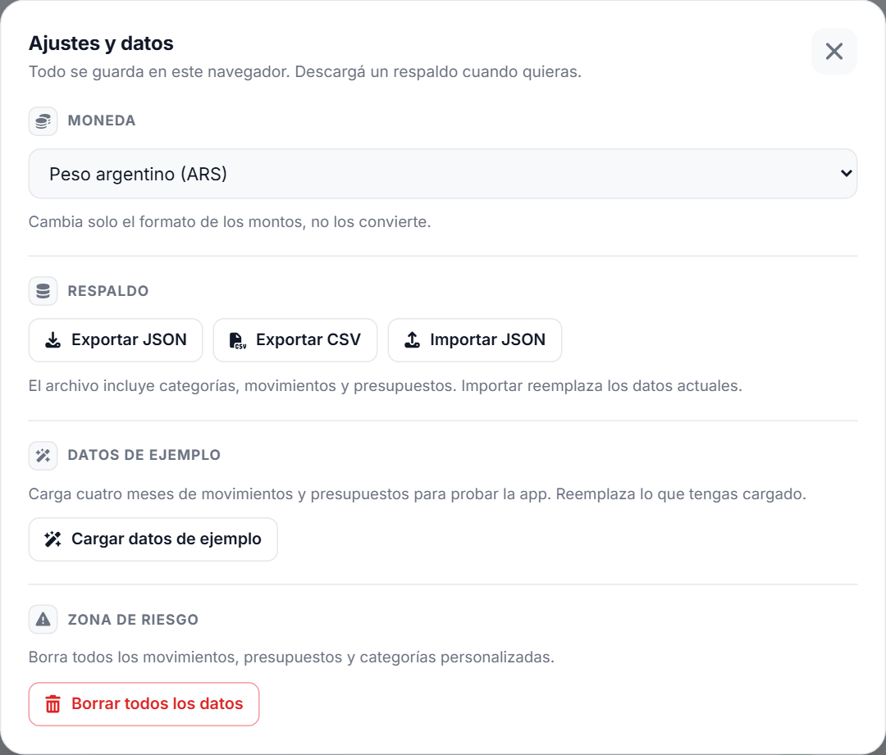

# 📖 Manual de uso

Guía paso a paso para usar **Gestor de gastos personales**.

- 🌐 Demo: [gestor-de-gastos-sandy.vercel.app](https://gestor-de-gastos-sandy.vercel.app/)
- 🏠 [Volver al README](README.md)

La app funciona **sin cuentas y sin backend**: todo se guarda en el navegador. Podés probarla con datos reales o cargar los datos de ejemplo desde Ajustes.



## Índice

1. [Primeros pasos](#1-primeros-pasos)
2. [La pantalla principal](#2-la-pantalla-principal)
3. [Registrar un movimiento](#3-registrar-un-movimiento)
4. [Editar y eliminar movimientos](#4-editar-y-eliminar-movimientos)
5. [Buscar y filtrar](#5-buscar-y-filtrar)
6. [Categorías](#6-categorías)
7. [Presupuestos](#7-presupuestos)
8. [Navegar por meses](#8-navegar-por-meses)
9. [Gráficos](#9-gráficos)
10. [Ajustes y datos](#10-ajustes-y-datos)
11. [Instalar como app](#11-instalar-como-app)
12. [Privacidad y datos](#12-privacidad-y-datos)
13. [Preguntas frecuentes](#13-preguntas-frecuentes)
14. [Glosario](#14-glosario)

## 1. Primeros pasos

1. Abrí la [demo](https://gestor-de-gastos-sandy.vercel.app/) o ejecutá la app en local.
2. Si es tu primera vez, andá a **⚙️ Ajustes → Moneda** y elegí la moneda que usás.
3. Cargá tu primer movimiento desde el formulario **Nuevo movimiento**.
4. Opcional: definí presupuestos mensuales y creá tus propias categorías.

Si querés explorar la app con información cargada, usá **⚙️ Ajustes → Cargar datos de ejemplo**. Se cargan cuatro meses de movimientos y presupuestos, pero **reemplaza** lo que tengas cargado.

> 💡 Antes de probar la importación, el borrado o los datos de ejemplo, exportá un respaldo JSON.

## 2. La pantalla principal

La pantalla se divide en cinco zonas:

| Zona | Qué muestra |
| --- | --- |
| **Encabezado** | Nombre, mes seleccionado, acceso a categorías, ajustes y tema claro/oscuro. |
| **Resumen del mes** | Ingresos, gastos, balance y tasa de ahorro. |
| **Nuevo movimiento / Movimientos** | Formulario de carga y lista del mes con filtros. |
| **Presupuestos / Gráficos** | Límites por categoría, dona de gastos y evolución de 6 meses. |
| **Pie** | Recordatorio de que los datos son locales. |

### Tarjetas de resumen

- **Ingresos**: suma de todos los ingresos del mes seleccionado.
- **Gastos**: suma de todos los gastos del mes.
- **Balance**: ingresos − gastos. Si es negativo se muestra en rojo.
- **Ahorro**: porcentaje de los ingresos que quedó como balance. Si no hay ingresos, muestra `—`.
- **Comparación**: cada tarjeta indica la variación porcentual contra el mes anterior. En ingresos y balance, subir es bueno; en gastos, subir es malo. Si el mes anterior no tiene datos, muestra “Sin datos del mes anterior”.

## 3. Registrar un movimiento



1. Elegí el tipo: **Gasto** o **Ingreso**.
2. Escribí el **monto**. Podés usar coma o punto decimal: `1500,50` y `1500.50` son equivalentes.
3. Elegí una **categoría** del tipo correspondiente.
4. Revisá la **fecha** (viene con la fecha de hoy si estás en el mes actual).
5. Agregá una **nota** si querés. Es opcional y admite hasta 80 caracteres.
6. Presioná **Agregar movimiento**.

Detalles útiles:

- El monto debe ser **mayor a cero** y se guarda con hasta dos decimales.
- Si no hay categorías del tipo elegido, el formulario ofrece un enlace para **crear una**.
- Después de guardar, se limpian el monto, la categoría y la nota, y el movimiento aparece en la lista.
- Si cargás un movimiento con una fecha de **otro mes**, la app navega automáticamente a ese mes.
- En un mes distinto al actual, la fecha por defecto es el **día 1** de ese mes.

## 4. Editar y eliminar movimientos

### Editar

1. En la lista de movimientos, presioná el lápiz ✏️ del movimiento.
2. El formulario cambia a **Editar movimiento** y carga los datos.
3. Modificá lo que necesites y presioná **Guardar cambios**.
4. Para descartar los cambios, usá **Cancelar**.

### Eliminar

1. Presioná el tacho de basura 🗑️ del movimiento.
2. Confirmá en el diálogo **“¿Eliminar este movimiento?”**.

La eliminación es inmediata y **no se puede deshacer**. Si estabas editando ese movimiento, la edición se cancela.

## 5. Buscar y filtrar

La lista de movimientos tiene tres controles:

- **Tipo**: todos, solo gastos o solo ingresos.
- **Categoría**: se adapta al tipo elegido.
- **Buscar**: coincide con la **nota** o con el **nombre de la categoría**, sin distinguir mayúsculas y minúsculas.

El subtítulo de la lista muestra la cantidad de movimientos visibles y el **neto** (ingresos − gastos) de lo filtrado. Si hay filtros activos aparece **Limpiar filtros**.

Los movimientos se ordenan siempre por fecha, del más reciente al más antiguo.

> La búsqueda no ignora tildes: “Educación” encuentra “educación”, pero no “educacion”.

## 6. Categorías

Abrí el gestor con el ícono de etiquetas 🏷️ del encabezado.



### Crear una categoría

1. Elegí **Gasto** o **Ingreso**.
2. Escribí un nombre de **2 a 32 caracteres**.
3. Elegí un ícono de la paleta rápida o escribí un emoji.
4. Elegí un color.
5. Presioná **Agregar categoría**.

No se permiten dos categorías con el mismo nombre dentro del mismo tipo.

### Editar

Usá el lápiz ✏️ de la categoría, cambiá los datos y guardá. También podés cancelar la edición.

> ⚠️ Evitá cambiar el tipo de una categoría que ya tiene movimientos: los movimientos existentes conservan su tipo original y la categoría deja de aparecer en el formulario de ese tipo.

### Eliminar

1. Presioná el tacho 🗑️ de la categoría.
2. Confirmá el diálogo.

Al eliminar una categoría **también se eliminan todos sus movimientos y presupuestos** en todos los meses. El diálogo te avisa cuántos movimientos se van a borrar.

Cada categoría muestra cuántos movimientos tiene (`X mov.`).

## 7. Presupuestos

Los presupuestos son **por mes** y solo aplican a categorías de **gasto**.



### Definir un límite

1. Escribí un monto en el campo de la categoría.
2. El presupuesto se guarda automáticamente.
3. Para quitarlo, dejá el campo vacío o poné `0`.

### Leer el panel

- **Presupuestado**: suma de los límites definidos para el mes.
- **Gastado**: suma de los gastos del mes en esas categorías.
- **Disponible**: presupuestado − gastado. Si es negativo, se muestra en rojo.
- **Barra de avance**: normal por debajo del 80 %, en amarillo desde el 80 % y en rojo al superar el 100 %.
- **Porcentaje**: gasto dividido presupuesto.

### Copiar el mes anterior

El botón **Copiar mes anterior** trae los presupuestos del mes previo y **reemplaza** los del mes actual. Está deshabilitado si el mes anterior no tiene presupuestos.

## 8. Navegar por meses

Usá las flechas **‹** y **›** del encabezado para moverte mes a mes. Cuando no estás en el mes actual aparece el botón **Hoy** para volver.

Al cambiar de mes se actualizan el resumen, la lista, los presupuestos y los gráficos. Los movimientos, presupuestos y categorías son los mismos: solo cambia el período que estás mirando.

## 9. Gráficos

- **Gastos por categoría**: dona con el desglose del mes seleccionado. Muestra las seis categorías con más gasto y agrupa el resto en **Otras categorías**. En el centro aparece el total gastado.
- **Ingresos vs. gastos**: barras de los últimos seis meses, incluyendo el mes seleccionado. Verde para ingresos y rojo para gastos. Pasá el mouse por una barra para ver el monto exacto.

Si no hay gastos en el mes, la dona muestra un mensaje vacío. Si no hay historial, el gráfico de barras también lo indica. Los gráficos se cargan de forma diferida para no demorar la primera pintura.

## 10. Ajustes y datos

Abrí **⚙️ Ajustes** desde el engranaje del encabezado.



### Moneda

Hay seis opciones: ARS, USD, EUR, MXN, CLP y COP. Cambiar la moneda **solo cambia el formato**: no convierte los montos existentes.

### Exportar JSON

Descarga un respaldo completo con moneda, categorías, movimientos y presupuestos. El archivo se llama `gestor-gastos-AAAA-MM-DD.json`. Es el formato que usa la importación.

### Exportar CSV

Descarga **todos los movimientos** (no solo el mes visible) en orden cronológico, con las columnas:

| Fecha | Tipo | Categoría | Monto | Nota |
| --- | --- | --- | --- | --- |
| 2026-11-27 | Gasto | Ocio | 42000 | Salida con amigos |

El CSV incluye BOM UTF-8 y saltos de línea CRLF para que Excel abra bien los acentos. Los montos van como números, sin símbolo de moneda.

### Importar JSON

Reemplaza **todos** los datos actuales por los del archivo. No fusiona ni suma. Si el archivo no es un JSON válido o no tiene el formato esperado, la app muestra un error y no cambia nada.

### Datos de ejemplo

Carga cuatro meses de movimientos y presupuestos para probar la app. Si ya hay movimientos, pide confirmación porque **reemplaza** los datos actuales.

### Borrar todos los datos

Es un borrado en dos pasos: el botón cambia a **Confirmar borrado**. Elimina movimientos, presupuestos y categorías personalizadas, y restaura las categorías iniciales. Mantiene la moneda elegida. **No se puede deshacer**.

## 11. Instalar como app

La app es una PWA: se puede instalar y usar sin conexión.

Para probarla en local, usá el build de producción:

```bash
npm run build
npm run preview
```

Luego abrí `http://localhost:4173`.

- **Chrome/Edge en escritorio**: ícono de instalar en la barra de direcciones, o menú → *Instalar Gestor de gastos*.
- **Android**: menú del navegador → *Agregar a pantalla principal* / *Instalar app*.
- **iPhone/iPad**: Safari → Compartir → *Agregar a pantalla de inicio*.

Una vez instalada se abre en modo standalone, sin la barra del navegador, y funciona offline. En el ícono aparece el nombre corto **Gastos**.

> Con `npm run dev` no se activa el service worker, por eso la opción de instalar no aparece en desarrollo.

## 12. Privacidad y datos

- **No hay backend, cuentas ni tracking.** Los datos se guardan en `localStorage` del navegador.
- Claves usadas: `gestor-gastos:v1` para los datos y `gestor-gastos:theme` para el tema.
- La única petición externa es la tipografía de Google Fonts; el service worker la cachea para uso offline.
- Si borrás los datos del navegador, desinstalás la PWA borrando sus datos o usás otro navegador/dispositivo, **los datos no se comparten ni se recuperan solos**.
- Para mover información entre dispositivos, exportá el JSON en uno e importalo en el otro.

## 13. Preguntas frecuentes

**No veo un movimiento que acabo de cargar.**
Revisá que estés en el mes correcto y que no haya filtros activos. Si cargaste una fecha de otro mes, la app te lleva a ese mes automáticamente.

**La opción de instalar no aparece.**
Necesita HTTPS o `localhost`, y el build de producción (`npm run build && npm run preview`). En `npm run dev` el service worker está desactivado.

**Cambié la moneda y los montos siguen iguales.**
Es intencional: la moneda solo cambia el formato, no hace conversión de divisas.

**¿Puedo usar la app en el celular y en la compu con los mismos datos?**
No hay sincronización. Cada navegador tiene sus propios datos. Usá exportar/importar JSON para pasarlos.

**¿Dónde queda el respaldo?**
En la carpeta de descargas del navegador, con el nombre `gestor-gastos-AAAA-MM-DD.json` o `.csv`.

**¿Puedo recuperar datos borrados?**
Solo si tenés un respaldo JSON exportado. La app no guarda historial de cambios.

**La app no muestra una actualización reciente.**
El service worker se actualiza solo, pero puede tardar. Cerrá y volvé a abrir la app, o recargá con `Ctrl + F5`. Si estás en GitHub Pages, verificá que el workflow de deploy haya terminado.

**¿Los datos de ejemplo son reales?**
No. Son movimientos ficticios generados para probar la app.

## 14. Glosario

| Término | Significado |
| --- | --- |
| **Movimiento** | Un ingreso o gasto con monto, categoría, fecha y nota. |
| **Categoría** | Agrupación de movimientos, con nombre, emoji y color. |
| **Presupuesto** | Límite de gasto por categoría para un mes. |
| **Balance** | Ingresos − gastos del mes. |
| **Ahorro** | Porcentaje del ingreso que queda como balance. |
| **Neto** | Ingresos − gastos de la lista filtrada. |
| **PWA** | Aplicación web instalable que puede funcionar offline. |
