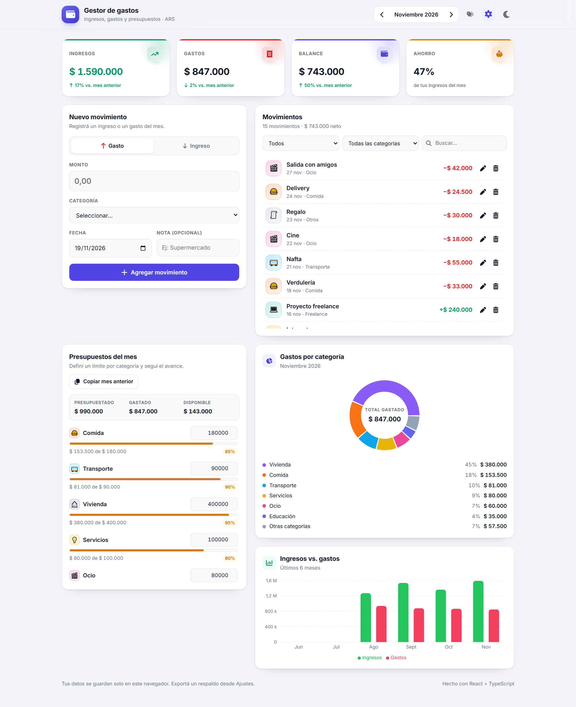
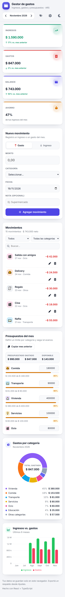
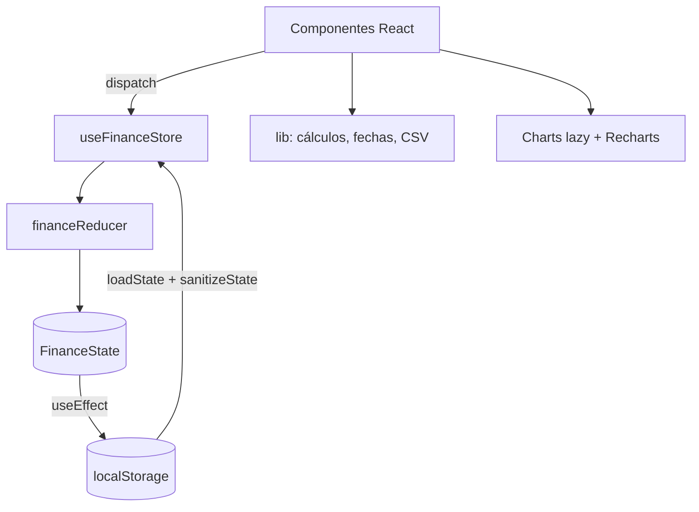

# 💰 Gestor de gastos personales

Aplicación web para registrar ingresos y gastos, organizarlos por categorías, definir presupuestos mensuales y entender la evolución de tus finanzas con gráficos.

Es una app **local-first**: no hay backend, cuentas ni tracking. Los datos viven en el `localStorage` del navegador, se puede instalar como PWA y funciona sin conexión.

**Demo:** [gestor-de-gastos-sandy.vercel.app](https://gestor-de-gastos-sandy.vercel.app/) · **Manual:** [MANUAL.md](MANUAL.md)

[](https://github.com/Vlobos01/gestor-de-gastos/actions/workflows/ci.yml)
[](https://github.com/Vlobos01/gestor-de-gastos/actions/workflows/deploy.yml)


## Demo en vivo

**[https://gestor-de-gastos-sandy.vercel.app/](https://gestor-de-gastos-sandy.vercel.app/)**

Para probarla con información cargada: **⚙️ Ajustes → Cargar datos de ejemplo**.

📖 ¿Es tu primera vez? Mirá el **[manual de uso](MANUAL.md)** con el detalle de cada función.



<details>
<summary>Ver tema oscuro y vista móvil</summary>

### Tema oscuro


### Vista móvil



</details>

## Qué es

Resuelve una necesidad concreta: saber en qué se va la plata y cuánto margen queda, sin planillas ni cuentas en la nube. Permite cargar movimientos, definir presupuestos por categoría, comparar meses, visualizar la distribución de gastos y exportar respaldos.

El proyecto está pensado como pieza de portfolio para mostrar React con TypeScript, estado predecible, testing, accesibilidad, performance y CI/CD.

## Funcionalidades

### Movimientos

- Ingresos y gastos con monto, categoría, fecha y nota opcional.
- Acepta coma o punto decimal (`1500,50` = `1500.50`) y guarda con dos decimales.
- Validación de monto mayor a cero, categoría obligatoria y fecha válida.
- Edición en el mismo formulario y eliminación con confirmación.
- Si cargás un movimiento de otro mes, la app navega automáticamente a ese período.
- Lista ordenada por fecha descendente, con el neto de lo visible.

### Categorías

- Categorías separadas para **gastos** e **ingresos**, con nombre, emoji y color.
- Validación de nombre (2 a 32 caracteres) y de duplicados por tipo.
- Contador de movimientos por categoría.
- Al eliminar una categoría se eliminan también sus movimientos y presupuestos, con aviso previo.

### Presupuestos

- Límite mensual por categoría de gasto, con guardado automático.
- Resumen de presupuestado, gastado y disponible.
- Barra de avance con alerta desde el 80 % y estado excedido al superar el 100 %.
- Botón para copiar los presupuestos del mes anterior.
- Los presupuestos son independientes para cada mes.

### Análisis

- Tarjetas de **ingresos, gastos, balance y ahorro**.
- Comparación porcentual contra el mes anterior, con color según si la variación es buena o mala.
- Tasa de ahorro calculada sobre los ingresos del mes.
- Dona de **gastos por categoría**: seis principales + “Otras categorías”.
- Barras de **ingresos vs. gastos** de los últimos seis meses, con tooltips.
- Los gráficos se cargan de forma diferida para no bloquear la primera pintura.

### Datos y respaldo

- Exportación e importación de **todos los datos en JSON**, con validación del formato.
- Exportación de **todos los movimientos a CSV** con BOM UTF-8 y CRLF para Excel.
- Datos de ejemplo de cuatro meses para probar la app.
- Borrado total en dos pasos, restaurando las categorías iniciales.
- Persistencia automática en `localStorage` en cada cambio.

### Experiencia

- **Tema oscuro por defecto**, con cambio a claro desde el encabezado; la elección se recuerda.
- **Seis monedas**: ARS, USD, EUR, MXN, CLP y COP, formateadas con `Intl.NumberFormat`.
- **Responsive** de escritorio a móvil.
- **PWA instalable** con funcionamiento offline.
- **Accesibilidad**: teclado, foco visible, foco atrapado en modales, etiquetas ARIA y enlace para saltar al contenido.

## Stack tecnológico

| Tecnología | Versión | Rol |
| --- | --- | --- |
| **React** | 18.3 | UI declarativa basada en componentes. |
| **TypeScript** | 5.6 (strict) | Tipado de estado, props y lógica de negocio. |
| **Vite** | 5.4 | Dev server, build y code splitting. |
| **Recharts** | 2.15 | Gráficos SVG declarativos. |
| **Font Awesome** | 7.3 | Iconos SVG tree-shakeables. |
| **Vitest** | 2.1 | Runner de tests. |
| **Testing Library** | 16.1 | Tests de componentes centrados en el usuario. |
| **vite-plugin-pwa** | 2.0 | Manifest y service worker con Workbox 7. |
| **CSS custom properties** | — | Tema claro/oscuro sin dependencias de UI. |
| **localStorage** | — | Persistencia local sin backend. |
| **GitHub Actions** | — | CI y deploy automático a GitHub Pages. |

## Arquitectura



Flujo unidireccional:

1. **`App`** mantiene el estado de UI (mes, modales, edición) y consume `useFinanceStore`.
2. **`useFinanceStore`** envuelve un `useReducer` con `financeReducer` y persiste el estado en un `useEffect`.
3. **`financeReducer`** es puro: recibe estado y acción, y devuelve un estado nuevo sin mutaciones.
4. **`lib/`** concentra la lógica derivada y testeable: resúmenes, totales, series, presupuestos, fechas, formato y CSV.
5. Los componentes de presentación reciben datos y callbacks; no acceden al almacenamiento.

Ventajas: el reducer y la lógica se testean sin montar la UI, los cálculos no se duplican y la validación está en un único límite (carga e importación).

## Modelo de datos

```ts
export type TxType = 'income' | 'expense';

export type CurrencyCode = 'ARS' | 'USD' | 'EUR' | 'MXN' | 'CLP' | 'COP';

export interface Category {
  id: string;
  name: string;
  type: TxType;
  color: string;
  emoji: string;
}

export interface Transaction {
  id: string;
  type: TxType;
  amount: number;
  categoryId: string;
  date: string; // YYYY-MM-DD
  note: string;
}

export type BudgetMap = Record<string, Record<string, number>>;

export interface FinanceState {
  version: 1;
  currency: CurrencyCode;
  categories: Category[];
  transactions: Transaction[];
  budgets: BudgetMap;
}
```

Los presupuestos se guardan por mes y categoría:

```json
{
  "2026-11": {
    "cat-food": 180000,
    "cat-home": 400000
  }
}
```

### Acciones del reducer

| Acción | Efecto |
| --- | --- |
| `add-transaction` | Crea un movimiento con ID y lo agrega al inicio. |
| `update-transaction` | Reemplaza un movimiento por ID. |
| `delete-transaction` | Elimina un movimiento por ID. |
| `add-category` | Crea una categoría con ID. |
| `update-category` | Reemplaza una categoría por ID. |
| `delete-category` | Elimina la categoría, sus movimientos y sus presupuestos. |
| `set-budget` | Define o quita (`0`) el presupuesto de una categoría en un mes. |
| `copy-budgets` | Reemplaza los presupuestos del mes destino con los del origen. |
| `set-currency` | Cambia la moneda de formato. |
| `replace-state` | Reemplaza todo el estado (importación JSON). |
| `load-demo` | Carga los datos de ejemplo en la moneda actual. |
| `reset` | Vuelve al estado inicial conservando la moneda. |

### Validación y persistencia

- `sanitizeState` valida estructura, versión, moneda, categorías, movimientos, fechas y presupuestos al cargar e importar.
- Los movimientos inválidos o las categorías mal formadas se descartan en lugar de romper la app.
- Si el JSON no tiene el formato esperado, la importación falla con un mensaje claro y no modifica nada.
- `saveState` captura errores de cuota o almacenamiento bloqueado; la app sigue funcionando en memoria.

## Estructura del proyecto

```
src/
├─ components/
│  ├─ Header.tsx           # encabezado, navegación de mes, tema y accesos
│  ├─ MonthNavigator.tsx   # selector de mes con botón "Hoy"
│  ├─ SummaryCards.tsx     # ingresos, gastos, balance y ahorro
│  ├─ TransactionForm.tsx  # alta y edición de movimientos
│  ├─ TransactionList.tsx  # lista, filtros, búsqueda y acciones
│  ├─ BudgetPanel.tsx      # presupuestos por categoría
│  ├─ Charts.tsx           # dona y barras (carga diferida)
│  ├─ CategoryManager.tsx  # CRUD de categorías
│  ├─ SettingsModal.tsx    # moneda, respaldo, demo y borrado
│  └─ Modal.tsx            # modal accesible con foco atrapado
├─ hooks/
│  ├─ useFinanceStore.ts   # reducer + persistencia
│  └─ useTheme.ts          # tema claro/oscuro persistido
├─ lib/
│  ├─ calculations.ts      # resúmenes, totales, presupuestos y series
│  ├─ csv.ts               # exportación CSV compatible con Excel
│  ├─ date.ts              # fechas y claves YYYY-MM
│  ├─ defaults.ts          # categorías iniciales
│  ├─ format.ts            # moneda, porcentajes y paleta
│  ├─ seed.ts              # datos de ejemplo
│  └─ storage.ts           # carga, guardado y validación
├─ test/setup.ts           # setup de Testing Library
├─ App.tsx                 # composición de la pantalla
├─ main.tsx                # punto de entrada
├─ styles.css              # estilos y variables de tema
└─ types.ts                # tipos del dominio

MANUAL.md                  # manual de uso paso a paso
docs/                      # capturas para README y manual
public/                    # favicon e iconos PWA / iOS
.github/workflows/         # CI y deploy a GitHub Pages
vercel.json                # configuración de deploy en Vercel
```

Los tests viven junto a cada módulo (`*.test.ts` y `*.test.tsx`).

## Instalación y uso local

Requisitos: **Node.js 20.19 o superior** y npm.

```bash
git clone https://github.com/Vlobos01/gestor-de-gastos.git
cd gestor-de-gastos
npm install
npm run dev
```

Abrí la URL que muestra Vite (por defecto `http://localhost:5173`).

Para explorar la app con datos cargados: **⚙️ Ajustes → Cargar datos de ejemplo**.

### Build de producción

```bash
npm run build     # chequea tipos y genera dist/
npm run preview   # sirve el build localmente
```

## Scripts

| Script | Qué hace |
| --- | --- |
| `npm run dev` | Dev server de Vite con HMR. |
| `npm run build` | Ejecuta `tsc --noEmit` y genera `dist/`. |
| `npm run preview` | Sirve el build de producción localmente. |
| `npm run typecheck` | Verifica tipos sin emitir archivos. |
| `npm test` | Corre la suite completa una vez. |
| `npm run test:watch` | Tests en modo watch. |

## Tests

**115 tests en 16 archivos**, con Vitest, jsdom y Testing Library.

| Área | Qué cubre |
| --- | --- |
| `lib/calculations` | Resúmenes, gastos por categoría, series mensuales y presupuestos. |
| `lib/date` | Fechas ISO, claves de mes, desplazamiento y etiquetas. |
| `lib/format` | Moneda, porcentajes y números compactos. |
| `lib/csv` | Encabezados, escape RFC 4180, BOM y orden cronológico. |
| `lib/storage` | Carga, sanitización e importación de respaldos inválidos. |
| `hooks/useFinanceStore` | Cada acción del reducer y la persistencia. |
| `hooks/useTheme` | Tema inicial, cambio y persistencia. |
| `components/*` | Formulario, lista, filtros, presupuestos, categorías, modales y tarjetas. |
| `App` | Flujo de integración: alta, navegación, demo, borrado y modales. |

```bash
npm test          # una vez
npm run test:watch
```

El workflow `.github/workflows/ci.yml` corre `npm ci`, `npm test` y `npm run build` en cada push a `main` y en cada pull request.

## PWA

- **Manifest** con nombre, descripción, `standalone`, colores, `start_url` y scope relativos.
- **Service worker** con Workbox: precache del shell y assets, navegación offline y caché de las fuentes de Google.
- **Actualización automática** (`autoUpdate`) al publicar una versión nueva.
- **Iconos** de 192, 512, maskable 512 y apple-touch-icon para iOS.

Para probar la instalación en local hace falta el build de producción, porque el service worker no se activa con `npm run dev`:

```bash
npm run build
npm run preview
```

- **Chrome/Edge en escritorio:** icono de instalar en la barra de direcciones, o menú → *Instalar Gestor de gastos*.
- **Android:** menú del navegador → *Agregar a pantalla principal* / *Instalar app*.
- **iPhone/iPad:** Safari → Compartir → *Agregar a pantalla de inicio*.

En GitHub Pages se sirve por HTTPS, así que queda instalable automáticamente.

## Accesibilidad

- Estructura semántica con `header`, `main`, `section` y encabezados jerárquicos.
- Enlace **“Saltar al contenido”** para usuarios de teclado.
- Formularios con etiquetas asociadas y errores con `role="alert"`.
- Modales con `role="dialog"`, `aria-modal`, foco atrapado y cierre con `Escape`.
- Foco visible, navegación de mes anunciada con `aria-live` y botones de iconos con `aria-label`.
- Contraste y colores de estado definidos con variables para ambos temas.

La suite usa consultas accesibles (`getByRole`, `getByLabelText`) y verifica el foco inicial y el retorno de foco en los modales.

## Privacidad y datos

- **No hay backend, cuentas ni analytics.** Los datos no salen del navegador.
- Claves de `localStorage`: `gestor-gastos:v1` (datos) y `gestor-gastos:theme` (tema).
- La única petición externa es la tipografía de Google Fonts; el service worker la cachea para uso offline.
- Borrar los datos del navegador, usar otro navegador o eliminar los datos de la PWA implica perder la información local.
- Para mover datos entre dispositivos: **Ajustes → Exportar JSON** en uno e **Importar JSON** en el otro.
- La importación **reemplaza** todo el estado actual; no fusiona datos.

## Deploy

La app se puede publicar en cualquier hosting estático. El repo queda listo para **Vercel** (deploy principal) y para **GitHub Pages** (alternativa), sin cambiar código.

### Vercel

Producción: **https://gestor-de-gastos-sandy.vercel.app/**

`vercel.json` define el framework, el comando de build, el directorio de salida y los headers de caché del service worker y del manifest.

1. Entrá a [vercel.com/new](https://vercel.com/new) e importá el repositorio `Vlobos01/gestor-de-gastos`.
2. Vercel detecta **Vite** automáticamente; no hace falta tocar build ni output.
3. **Deploy**. Cada push a `main` genera un deploy de producción y cada PR un preview.

La app se publica en la raíz del dominio, así que no hay subcarpeta.

### GitHub Pages (alternativa)

También queda publicada una copia en **https://Vlobos01.github.io/gestor-de-gastos/** mediante `.github/workflows/deploy.yml`, que corre los tests, compila y publica en cada push a `main`.

1. Subí el proyecto a un repositorio de GitHub.
2. En el repo: **Settings → Pages → Build and deployment → Source: GitHub Actions**.
3. Hacé push a `main` y esperá a que termine el workflow.

El workflow usa `actions/configure-pages` con `enablement: true`, así que también puede habilitar Pages automáticamente la primera vez.

La app se publica en `https://<usuario>.github.io/<repo>/`. El `base: './'` de Vite hace que funcione en subcarpetas sin cambios.

## Decisiones técnicas

| Decisión | Por qué | Trade-off |
| --- | --- | --- |
| **`localStorage` en lugar de backend** | Privacidad, costo cero y uso inmediato sin registro. | Los datos no se sincronizan entre dispositivos. |
| **`useReducer` + custom hook** | Transiciones explícitas, estado predecible y reducer testeable. | Más ceremonia que `useState` para una app pequeña. |
| **Lógica derivada en `lib/`** | Cálculos puros, reutilizables y fáciles de testear. | Hay que mantener separadas las funciones de presentación. |
| **Fechas `YYYY-MM-DD` y meses `YYYY-MM`** | Comparación lexicográfica, filtrado simple y sin problemas de zona horaria. | No soporta rangos arbitrarios ni zonas horarias. |
| **Validación manual del JSON** | Evita importar datos corruptos sin agregar una dependencia de esquemas. | El esquema se mantiene a mano. |
| **Recharts con `React.lazy`** | El bundle inicial no carga la librería de gráficos. | Aparece un estado breve de “Cargando gráficos…”. |
| **CSS con variables** | Tema claro/oscuro y diseño propio sin dependencias de UI. | Más CSS escrito a mano. |
| **PWA con `autoUpdate`** | Los usuarios reciben la última versión sin intervención. | El ciclo de vida del service worker puede demorar la actualización. |
| **`base: './'`** | Funciona en la raíz o en subcarpetas como GitHub Pages. | Hay que usar rutas relativas en assets y manifest. |

## Limitaciones conocidas

- Una sola persona y un solo navegador: no hay cuentas ni sincronización.
- La moneda cambia el formato, **no convierte** montos.
- No hay movimientos recurrentes ni gastos programados.
- No se puede deshacer un borrado; conviene exportar respaldos.
- La importación JSON reemplaza todos los datos.
- Los gráficos muestran el mes seleccionado y una ventana de seis meses.
- La interfaz está en español y los datos de ejemplo están pensados para ARS.
- No hay exportación a PDF.

## Roadmap

- Sincronización opcional en la nube (Supabase/Firebase) manteniendo el modo local.
- Movimientos recurrentes y objetivos de ahorro.
- Recordatorios de gastos fijos y suscripciones.
- Exportación de reportes a PDF.
- Importación de movimientos desde CSV.

## Licencia

MIT. Ver [LICENSE](LICENSE).

Los iconos de la interfaz provienen de [Font Awesome Free](https://fontawesome.com/) y se usan bajo su licencia CC BY 4.0.

---

Hecho por [Agustín Vergalobos](https://github.com/Vlobos01). Comentarios y sugerencias: [abrí un issue](https://github.com/Vlobos01/gestor-de-gastos/issues).
