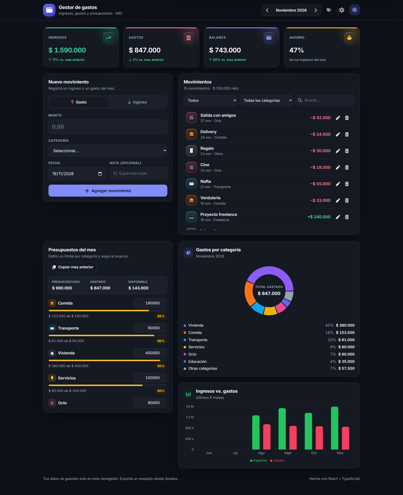

# 💰 Gestor de gastos personales

Aplicación web para registrar ingresos y gastos, organizarlos por categorías, definir presupuestos mensuales y visualizar la evolución de tus finanzas con gráficos.

Tus datos se guardan **solo en tu navegador** (`localStorage`): no hay backend, cuentas ni tracking.

[](https://github.com/Vlobos01/gestor-de-gastos/actions/workflows/ci.yml)
[](https://github.com/Vlobos01/gestor-de-gastos/actions/workflows/deploy.yml)


## 🔗 Demo en vivo

**[https://Vlobos01.github.io/gestor-de-gastos/](https://Vlobos01.github.io/gestor-de-gastos/)**

Para probarla con información cargada: **⚙️ Ajustes → Cargar datos de ejemplo**.

📖 ¿Es tu primera vez? Mirá el **[manual de uso](MANUAL.md)** con el detalle de cada función.


<details>
<summary>Ver tema oscuro y vista móvil</summary>

### Tema oscuro



### Vista móvil


</details>

## ✨ Funcionalidades

- **Movimientos de ingresos y gastos** con monto, categoría, fecha y nota.
- **Categorías personalizables**: nombre, emoji y color. Se pueden crear, editar y eliminar tanto para gastos como para ingresos.
- **Presupuestos mensuales por categoría**, con barra de avance, alerta al superar el 80 % y disponible total. Botón para copiar los presupuestos del mes anterior.
- **Navegación por mes** con comparación contra el mes anterior en ingresos, gastos y balance.
- **Gráficos** (Recharts): gastos por categoría en dona e ingresos vs. gastos de los últimos 6 meses.
- **Filtros y búsqueda** en la lista de movimientos, edición y eliminación.
- **Tema claro/oscuro**, iconos de [Font Awesome](https://fontawesome.com/) y 6 monedas (ARS, USD, EUR, MXN, CLP, COP).
- **Respaldo**: exportar e importar todos los datos en JSON, exportar movimientos a CSV para planillas, cargar datos de ejemplo y borrar todo.
- **Responsive** y accesible: etiquetas, foco visible, foco atrapado en modales, enlace para saltar al contenido y navegación con teclado.
- **PWA instalable**: manifest, service worker y caché offline. Se puede instalar en escritorio, Android e iOS y seguir usando sin conexión.

## 🚀 Cómo correrlo

Requisitos: Node.js 20.19 o superior.

```bash
npm install
npm run dev
```

Abrí la URL que muestra Vite (por defecto `http://localhost:5173`).

### Build de producción

```bash
npm run build     # chequea tipos y genera dist/
npm run preview   # sirve el build localmente
```

### Tests

```bash
npm test          # corre la suite una vez (114 tests)
npm run test:watch
```

Los tests cubren la lógica pura (`src/lib`), el reducer de `useFinanceStore` y los componentes con Testing Library: cálculos de resumen, gastos por categoría, series mensuales, presupuestos, fechas, formato de moneda, exportación CSV, validación de respaldos, cada acción del reducer, formulario de movimientos, filtros, categorías, presupuestos, modales y un flujo de integración de la app.

El workflow de `.github/workflows/ci.yml` corre los tests y el build en cada push y pull request.

## 📲 Instalar como app (PWA)

La app incluye manifest, service worker y caché offline. Para probar la instalación en local hay que usar el build de producción, porque el service worker no se activa con `npm run dev`:

```bash
npm run build
npm run preview
```

- **Chrome/Edge en escritorio:** icono de instalar en la barra de direcciones, o menú → *Instalar Gestor de gastos*.
- **Android:** menú del navegador → *Agregar a pantalla principal* / *Instalar app*.
- **iPhone/iPad:** Safari → Compartir → *Agregar a pantalla de inicio*.

Una vez instalada se abre en modo standalone, sin barra del navegador, y funciona sin conexión. Los datos siguen guardándose en `localStorage`.

## ☁️ Deploy en GitHub Pages

El repo incluye un workflow en `.github/workflows/deploy.yml` que corre los tests, compila y publica la app en cada push a `main`.

1. Subí el proyecto a un repositorio de GitHub.
2. En el repo: **Settings → Pages → Build and deployment → Source: GitHub Actions**.
3. Hacé push a `main` y esperá a que termine el workflow.

La app se publica en `https://<usuario>.github.io/<repo>/`. El `base: './'` de Vite hace que funcione en subcarpetas sin cambios. Como Pages sirve por HTTPS, la PWA queda instalable automáticamente.

## 🧱 Stack y decisiones

| Pieza | Uso |
| --- | --- |
| **React 18 + TypeScript** | UI con componentes tipados y lógica separada en `lib/`. |
| **Vite** | Dev server y build. |
| **Recharts** | Gráficos declarativos sobre SVG. |
| **Font Awesome** | Set de iconos SVG oficial (free-solid, tree-shakeable) para toda la interfaz. |
| **Vitest + Testing Library** | 114 tests de la lógica de negocio, del reducer y de los componentes. |
| **vite-plugin-pwa + Workbox** | Manifest, service worker, precache del shell y caché de las fuentes para uso offline. |
| **localStorage** | Persistencia sin backend, con validación al cargar e importar. |
| **Reducer + custom hook** | Estado centralizado y predecible en `useFinanceStore`. |
| **CSS con variables** | Tema claro/oscuro sin dependencias adicionales. |
| **GitHub Actions** | CI en cada push/PR y deploy automático a Pages. |

## 📁 Estructura

```
src/
├─ components/          # UI: header, formularios, listas, gráficos, modales
├─ hooks/
│  ├─ useFinanceStore.ts  # reducer + persistencia
│  └─ useTheme.ts         # tema claro/oscuro
├─ lib/
│  ├─ calculations.ts     # resúmenes, totales por categoría, presupuestos, series
│  ├─ csv.ts              # exportación de movimientos a CSV
│  ├─ date.ts             # fechas y claves de mes (YYYY-MM)
│  ├─ defaults.ts         # categorías iniciales
│  ├─ format.ts           # moneda, porcentajes, paleta de colores
│  ├─ seed.ts             # datos de ejemplo
│  └─ storage.ts          # carga, guardado y validación del JSON
├─ test/setup.ts          # setup de Testing Library y stubs del navegador
├─ App.tsx
├─ main.tsx
├─ styles.css
└─ types.ts

MANUAL.md                 # manual de uso paso a paso
docs/                     # capturas para el README y el manual
public/
├─ favicon.svg
├─ pwa-192x192.png        # icono PWA
├─ pwa-512x512.png        # icono PWA
├─ pwa-maskable-512x512.png
└─ apple-touch-icon.png   # icono para iOS
.github/workflows/        # CI y deploy a GitHub Pages
```

### Modelo de datos

```ts
interface FinanceState {
  version: 1;
  currency: 'ARS' | 'USD' | 'EUR' | 'MXN' | 'CLP' | 'COP';
  categories: Category[];        // ingresos y gastos, con color y emoji
  transactions: Transaction[];   // monto, tipo, categoría, fecha y nota
  budgets: Record<string, Record<string, number>>; // mes → categoría → límite
}
```

## 🗺️ Próximos pasos

- Sincronización opcional en la nube (Supabase/Firebase) manteniendo el modo local.
- Presupuestos recurrentes y objetivos de ahorro.
- Recordatorios de gastos fijos y suscripciones.
- Exportar reportes a CSV/PDF.

## 📄 Licencia

MIT. Ver [LICENSE](LICENSE).

Los iconos de la interfaz provienen de [Font Awesome Free](https://fontawesome.com/) y se usan bajo su licencia CC BY 4.0.

---

Hecho por [Agustín Vergalobos](https://github.com/Vlobos01).
